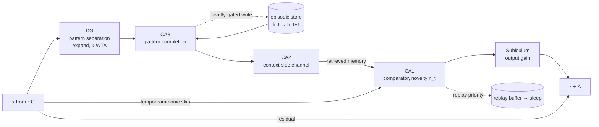

# limbic-llm

[](https://github.com/realdanielbyrne/limbic-llm/actions/workflows/tests.yml)
[](LICENSE)


**Hippocampus-inspired memory for language models, in PyTorch.**

The hippocampus learns new facts in a single exposure without overwriting old ones, and retrieves them from partial cues. limbic-llm builds each stage of the hippocampal circuit as a neural-network module and tests whether the brain's design choices help sequence models remember beyond their attention window and learn continually without forgetting.

It is a research library, not a pretrained LLM: memory modules you can drop into a transformer, plus small language models for controlled experiments.

## What's inside

* **Strategy I, the direct circuit.** EC → DG → CA3 → CA2 → CA1 → Subiculum as one residual block, with a one-shot episodic store in CA3.
* **Strategy II, a Titans hybrid.** The Titans test-time memory ([Behrouz et al., 2024](https://arxiv.org/abs/2501.00663)) with a dentate-gyrus write path, a CA1 comparator and novelty-scaled learning rates.
* **Gated DeltaNet memory.** The linear special case of the Titans memory ([Yang et al., 2025](https://arxiv.org/abs/2412.06464)), with exact per-token updates, a fast chunkwise kernel and dentate-gyrus addressing.
* **Replay consolidation.** A novelty-prioritized replay buffer and an offline "sleep" phase that trains only the slow parameters, after the complementary learning systems theory.
* **A regulated temporal loop.** The model's own lagged activations are written into an associative memory and fed back as clamped, damped sinusoids that weaken on every circuit, as a contrast of episode against prior, under CA1 negative-feedback gain control. A clock of elapsed time, built from scale-invariant time cells, rides alongside. See [the design note](docs/design/temporal-loop.md).



## Results

Small CPU models (0.2–0.4 M parameters, single seed), so these are sanity checks rather than benchmarks. Full details are in [RESULTS.md](RESULTS.md).

**One-shot recall beyond the attention window.** The model sees 6 key→value pairs, 40 filler tokens, then is queried on every key. Local models see 16 tokens at a time; chance is 0.06.

| Model | Recall |
|---|---:|
| Windowed attention, no memory | 0.06 |
| Full attention, sees everything | 0.49 |
| Strategy I (HippocampalLM) | 0.41 |
| Titans (deep memory) | 0.48 |
| **Titans with a Gated DeltaNet memory** | **1.00** |
| Titans with Gated DeltaNet + DG addresses | 0.99 |

**Continual learning.** Learning three fact sets in sequence, naive training forgets badly (backward transfer −0.73). Novelty-prioritized replay with a sleep phase removes the forgetting (backward transfer 0.00).

**Memory capacity.** Standard Gated DeltaNet loses recall once the number of stored pairs exceeds its key dimension (0.43 → 0.13). Successor-bound addressing turns the state into exact RAM, with perfect recall up to 32 pairs.

**A regulated temporal loop and a clock of elapsed time.** On a task that asks what happened and how long ago, beyond a 16-token window, the loop carries content and the clock carries elapsed time; each alone leaves the other at baseline.

| Model | What (chance 0.125) | When (prior 0.333) |
|---|---:|---:|
| Windowed attention | 0.11 | 0.34 |
| Memory loop | 1.00 | 0.85 |
| Clock | 0.10 | 0.88 |
| Loop + clock (3,000 steps; others 1,500) | **1.00** | **0.92** |

Closed loops that feed their output back into memory run away when undamped (echo 14× the input, peak 63×). The clamped, damped loop with CA1 control holds the echo at about 0.3× across 520 tokens and still learns the task on two seeds. Two findings shaped the design. A closed loop rehearses, so the *first* event captures it however strongly each trace is damped; subtracting the prior and sparse dentate-gyrus keys counter this. And CA1's inverted copy obeys the op-amp law, $y = A\Delta/(1+A\beta)$, but only below a loop gain of 1.68, because it arrives a circuit late. On frozen Qwen3.5-2B, the side channels restore exact needle recall 500 tokens back (0.00 → 1.00) with help from its Gated DeltaNet layers. See [RESULTS.md §4](RESULTS.md#4-temporal-loop-what-when-stability-and-feedback).

## Install

```bash
git clone https://github.com/realdanielbyrne/limbic-llm
cd limbic-llm
pip install -e ".[dev]"      # needs torch >= 2.1
pytest -q                    # 100 tests (12 need the [pretrained] extra)
```

## Quick start

**A language model with a hippocampal memory block**

```python
from limbic_llm import HippocampalLM, lm_loss, novelty_alignment_loss

model = HippocampalLM(vocab=32000, d_model=256, n_heads=8,
                      n_ec=2, n_hpc=1, n_neocortex=4,      # n_neocortex=0 for standalone mode
                      segment=128, ca3_capacity=512, ca3_write=32)
out = model(tokens)                                      # logits, novelty, memory state
tl = lm_loss(out.logits[:, :-1], tokens[:, 1:], reduction="none")
loss = tl.mean() + 0.1 * novelty_alignment_loss(out.novelty[:, :-1], tl)

out2 = model(next_tokens, state=out.state)               # memory carries across calls
```

**Titans with hippocampal additions, or with a Gated DeltaNet memory**

```python
from limbic_llm import TitansHippocampalLM

model = TitansHippocampalLM(vocab=32000, d_model=256, n_heads=8, n_layers=4,
                            variant="mac",                 # "mac" | "mag" | "mal"
                            use_dg=True, use_ca1=True, novelty_lr=True, sequential=True,
                            memory_type="gated_delta")     # or "titans" for the deep memory
```

Each hippocampal addition is a single flag, and all four off gives plain Titans, so ablations are one change each.

**A Gated DeltaNet language model, optionally hybrid with attention**

```python
from limbic_llm import GatedDeltaLM

lm = GatedDeltaLM(vocab=32000, d_model=256, n_heads=8, n_layers=8,
                  attn_every=4,                            # 3:1 DeltaNet:attention, as in Qwen3-Next
                  addressing="dg", key_expansion=8)        # "gdn" | "tied" | "dg"
```

**Drop the block into your own transformer**

```python
from limbic_llm import HippocampalBlock

block = HippocampalBlock(d_model=512, n_heads=8)
out = block(x, store=prev_store)                          # x: (B, T, 512)
x, prev_store = out.hidden, out.store
```

**Replay consolidation**

```python
from limbic_llm import PrioritizedReplayBuffer, Consolidator, sequence_priority

buffer = PrioritizedReplayBuffer(capacity=10_000)
consolidator = Consolidator(model, buffer, slow_params=model.neocortex.parameters(), lr=1e-4)

buffer.add(seq, sequence_priority(out.novelty, tl), out.logits)   # while awake
loss = task_loss + consolidator.replay_loss(batch_size=16)         # interleaved replay
consolidator.sleep(steps=200)                                      # offline consolidation
```

## How the circuit maps to code

| Region | Role | Module | Computation |
|---|---|---|---|
| Entorhinal cortex | Input encoding | `TransformerLayer` | Contextual embedding $x_t$ |
| Dentate gyrus | Pattern separation | `DentateGyrus` | Expand, keep the top $k = \lceil s \cdot d r\rceil$ units, optional neurogenesis |
| CA3 | Pattern completion | `CA3Autoassociative` | $\xi \leftarrow V^\top \text{softmax}(\beta K \xi)$ over a store of $h_t \mapsto h_{t+1}$ transitions |
| CA2 | Context side channel | `CA2Modulator` | $y = x \odot (1+\gamma(c)) + \beta(c)$ |
| CA1 | Comparator | `CA1Comparator` | $[a;\ r;\ a \odot r;\ \lvert a-r \rvert]$ → fused output and novelty $n_t$ |
| Subiculum | Output | `Subiculum` | Output gain $\text{softplus}(a\,n_t + b)$ |
| Titans memory | Test-time learning | `NeuralMemory` | $S_t = \eta S_{t-1} - \theta_t \nabla\ell$, $M_t = (1-\alpha)M_{t-1} + S_t$ |
| Gated DeltaNet | Linear associative memory | `GatedDeltaNet`, `GatedDeltaMemory` | $S_t = \alpha_t S_{t-1}(I - \beta_t k_t k_t^\top) + \beta_t v_t k_t^\top$ |
| Replay | Consolidation | `PrioritizedReplayBuffer`, `Consolidator` | Priority from novelty; sleep updates slow parameters only |

Gated DeltaNet is exactly one gradient step on the Titans loss $\tfrac12\lVert Sk_t - v_t\rVert^2$ at the decayed state $\alpha_t S_{t-1}$. Its decay gate $\alpha_t$ is the forgetting term, its write gate $\beta_t$ is encoding strength, and $v_t - \alpha_t S_{t-1}k_t$ is the prediction error CA1 computes. With one-hot keys and $\alpha = \beta = 1$ the state is exact RAM, as in [Qwenputer](https://divagr.com/blog/qwenputer), which is the limit that dentate-gyrus pattern separation approaches.

## Experiments

```bash
python experiments/assoc_recall.py --steps 3000      # one-shot recall across a long gap
python experiments/continual.py --steps 600          # sequential learning: naive vs. replay
python experiments/gdn_capacity.py --pairs 8,16,32   # linear-memory capacity under load
python experiments/temporal_loop.py --suite all      # what/when recall and closed-loop stability
python experiments/temporal_loop.py --suite feedback # CA1 feedback: none, divisive, subtractive
python experiments/temporal_loop.py --suite ablations # contrast, DG keys, direct vs DG read
python experiments/loop_systems.py                   # the op-amp test on an untrained loop
```

Side channels on a frozen pretrained model (needs `pip install -e ".[pretrained]"` and a GPU for real models):

```bash
python experiments/pretrained_loop.py --model Qwen/Qwen3.5-2B-Base --dtype bfloat16 --device cuda \
    --task needle --window 64 --window-layers attention --seq-len 512 --steps 3000
```

The temporal-loop experiment takes flags for each excitatory variant, so a single model can be built from the command line:

```bash
python experiments/temporal_loop.py --name mine --memory --time \
    --kernel osc --rho 0.6 --amp 1.0 --tau 16 \
    --loop closed --no-ca1-control --contrast --dg-keys
```

| Flag | Effect |
|---|---|
| `--kernel osc\|exp\|flat` | Re-entry kernel: clamped damped sinusoid, damped exponential, or undamped |
| `--rho`, `--amp`, `--tau` | Attenuation per circuit, peak feedback amplitude (clamped to ≤ 1), loop period in tokens |
| `--loop open\|closed` | Store the stream from before injection (acetylcholine-style) or after it (true feedback) |
| `--ca1-control` | Negative-feedback gain: error-only injection, energy-normalised gain below 1 |
| `--contrast` | Inject episode minus prior instead of the raw retrieval |
| `--dg-keys` | Sparse dentate-gyrus write keys, dense entorhinal read query |
| `--memory`, `--time` | Turn the loop and the clock on or off |
| `--feedback none\|divisive\|subtractive` | CA1 → CA3 back-projection: energy-divisive, or an inverted copy of earlier injections |
| `--clamp`, `--project`, `--saturate` | The other parts of CA1 control, each switchable |
| `--forward-gain`, `--fb-beta` | Open-loop gain $A$ and feedback fraction $\beta$ |
| `--read direct\|dg` | Retrieval cue straight from the stream (EC → CA3) or through the dentate-gyrus code |

Logs and JSON results are in [`results/`](results/).

## Lessons from the experiments

Three design changes came out of debugging, each covered by a test.

1. **CA3 must store sequences.** A purely autoassociative store returns the cue itself, so a key cannot recall its value. Binding each pattern to its successor, as in models of CA3 sequence memory, was needed before any memory model rose above chance.
2. **The Titans meta-gradient is a partial derivative.** When the chunk being written was itself computed from a read of the same memory, differentiating through it made training apply a different update than inference.
3. **Write scale needs a trust region.** Averaging the memory loss over features shrinks writes by $1/d$; summing, as in the paper, needs a per-sample clip to stay stable. Sparse DG keys were stable even without it.

## Roadmap

* **CA2 as identity steering.** Per-speaker activation-steering vectors ([Turner et al.](https://arxiv.org/abs/2308.10248)) at the CA2 point, tested on multi-speaker recall.
* **A calibrated CA1.** Novelty trained with a proper scoring rule, in the spirit of decision models such as [JEV](https://jevai.net) and [LAYA](https://github.com/NandhaKishorM/laya), with a JEPA-style predictive target.
* **Big-loop recurrence.** A looped HippocampalBlock whose exit gate is driven by CA1 novelty, after [Ouro](https://arxiv.org/abs/2510.25741).
* **A full Limbic LLM.** The temporal loop and the clock on a frozen pretrained decoder: tap at a third of the depth, inject at half, consolidate into adapters. The blueprint is in the [design note](docs/design/temporal-loop.md#4-a-full-limbic-llm); first results on Qwen3 and Qwen3.5 are in RESULTS.md §4.7.
* **Multi-band horizons.** Damping sets a memory span of about $\tau/\ln(1/\rho)$ tokens; several bands with different $\rho$, to keep both recency and long recall.
* **Pattern separation under similar keys.** A recall task with overlapping keys and a sweep of DG sparsity.
* **Pretrained models.** Inserting HippocampalBlock or GatedDeltaMemory into an existing LLM.

## Documentation

| | |
|---|---|
| [`docs/hippocampal_ml_architectures.docx`](docs/hippocampal_ml_architectures.docx) | The design document: circuit-to-ML mappings, Titans and Gated DeltaNet, recent inspirations, results |
| [`docs/genesis.md`](docs/genesis.md) | How the project came about: the session's ideas in order, who proposed what, and the corrections made along the way |
| [`docs/design/temporal-loop.md`](docs/design/temporal-loop.md) | The temporal loop: how the idea developed, biological stability, the design, plug-in versus new architecture, a full Limbic LLM |
| [`docs/architecture.html`](docs/architecture.html) | Package and data-flow diagrams (download and open in a browser) |
| [`docs/hippocampus_report.docx`](docs/hippocampus_report.docx) | Background on hippocampal structure and function |
| [`docs/notebooks/`](docs/notebooks/) | Activation Addition notebook (GPT-2-XL) |
| [RESULTS.md](RESULTS.md) | Full experimental results |
| [`docs/implementation-notes.md`](docs/implementation-notes.md) | Implementation details and simplifications |
| [REFERENCES.md](REFERENCES.md) | Bibliography, grouped by circuit component; BibTeX in [`docs/references.bib`](docs/references.bib) |

## Repository layout

```
limbic_llm/         memory modules and models
  dentate_gyrus.py  ca3.py  ca2.py  ca1.py  subiculum.py  hippocampal_block.py
  neural_memory.py  titans_hybrid.py  gated_delta.py  temporal_loop.py  replay.py  models.py
experiments/        recall, continual learning, capacity, temporal loop, op-amp sweep, pretrained models
tests/              100 tests
results/            experiment logs and JSON
docs/               design document, diagrams, bibliography, notebook
```

## Citing

```bibtex
@software{byrne2026limbicllm,
  author = {Byrne, Daniel},
  title  = {limbic-llm: Hippocampus-Inspired Memory for Language Models},
  year   = {2026},
  url    = {https://github.com/realdanielbyrne/limbic-llm}
}
```

This project was first called *hippoformer* and was renamed because an ICLR 2026 paper uses that name ([Li et al., 2026](https://mlanthology.org/iclr/2026/li2026iclr-hippoformer/)).

## License

[MIT](LICENSE)
